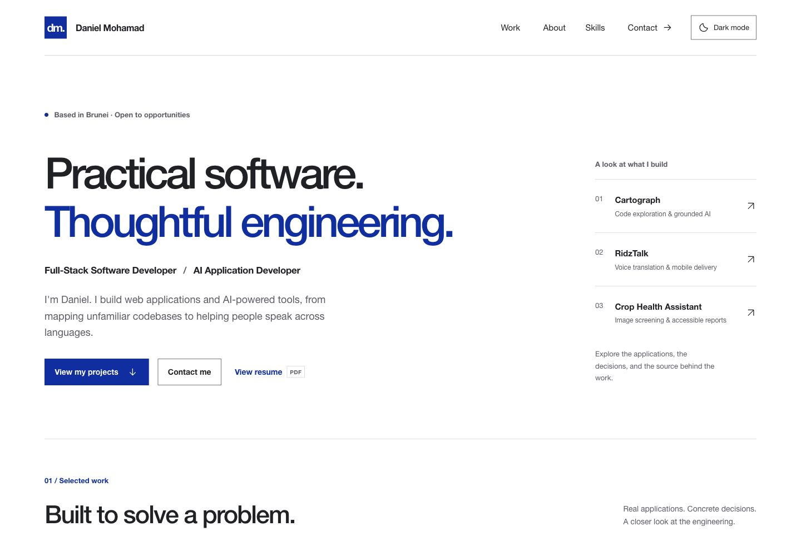
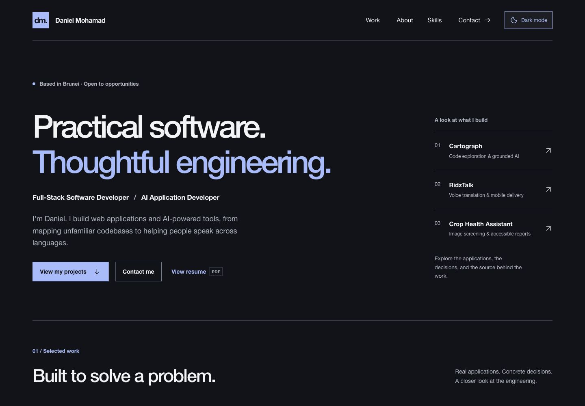
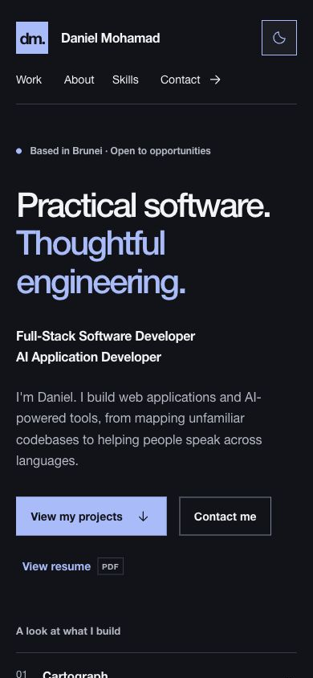
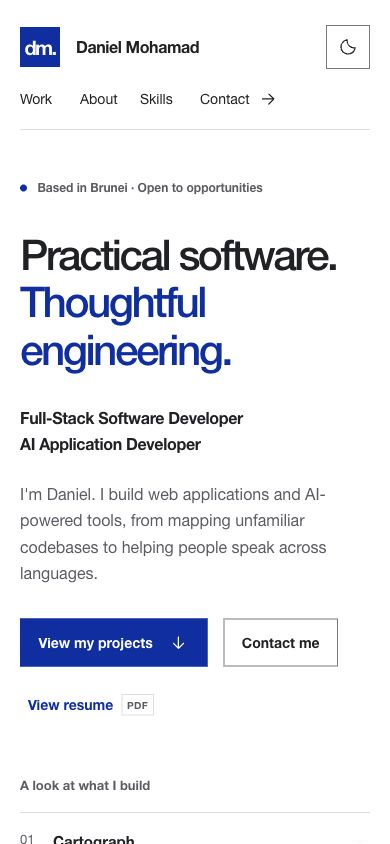

# Daniel Mohamad | Developer Portfolio

A static portfolio for Daniel Ridzwan Bin Mohamad, a Brunei-based full-stack software and AI application developer. It presents practical applications, the engineering decisions behind them, and direct routes to project evidence, a resume and contact details.

[Live portfolio](https://dannyridz.github.io/daniel.mohamad/)

The live portfolio is published through GitHub Pages from the `main` branch.

## Preview



<details>
<summary>Dark mode preview</summary>





</details>

<details>
<summary>Mobile preview</summary>



</details>

## Features

- Clear software development and AI application positioning, with project, contact and resume actions.
- Cartograph showcase with a real dependency-map screenshot, architecture notes, public source and a recorded walkthrough.
- RidzTalk showcase with a Google Play preview, audio engineering notes and a public technical case study with an isolated code sample. The production source remains private.
- Crop Health Assistant overview with team contribution, deployment and screening limitations.
- Categorized skills grounded in project source and documentation.
- Responsive layouts, always visible navigation, semantic landmarks, a keyboard skip link, visible focus, native disclosures and reduced motion support.
- Light and dark modes with a keyboard-accessible toggle, device preference detection and a remembered selection.
- Optimized project images, explicit dimensions, lazy loading, no remote fonts and no framework dependencies.
- Canonical URL, Open Graph and Twitter metadata, a 1200 × 630 social image and a local SVG favicon.

## Technology

The portfolio uses **HTML, CSS and a small vanilla JavaScript theme script**. The theme is applied before the stylesheet loads to avoid flashing the wrong theme. If JavaScript is unavailable, CSS still follows the device theme and navigation, content and case study disclosures continue to work. A standard-library Python script checks local links and metadata. No package installation, frontend framework, API keys, build process or backend is needed to serve it. Technologies mentioned in project case studies belong to those separate applications.

## Local development

```sh
git clone https://github.com/DannyRidz/daniel.mohamad.git
cd daniel.mohamad
python3 -m http.server 8000 --bind 127.0.0.1
```

Open [localhost:8000](http://127.0.0.1:8000). Stop the server with Ctrl+C. Opening `index.html` directly also works.

To test the real GitHub Pages subpath, start the server from the parent directory:

```sh
python3 -m http.server 8000 --bind 127.0.0.1 --directory ..
```

Then open `http://127.0.0.1:8000/daniel.mohamad/`.

## Project structure

```text
index.html                 Content, navigation and metadata
styles.css                 Design tokens, shared patterns and responsive styles
theme.js                   Theme preference, persistence and toggle behavior
design.md                  Visual direction and maintenance guidance
.htmlvalidate.json         HTML validation conventions
assets/images/             Project evidence, favicon and portfolio previews
assets/documents/          Existing public resume
scripts/check_site.py      Dependency-free link and metadata checks
scripts/check_theme.cjs    Theme behavior checks using Node's standard library
docs/audit.md              Original audit and prioritized plan
docs/research.md           Claim sources, project selection and limitations
docs/verification.md       Executed checks and remaining recommendations
docs/specs/                Recorded implementation decision
```

## Verification

Run the built-in checks:

```sh
python3 scripts/check_site.py
node scripts/check_theme.cjs
git diff --check
```

HTML validation uses `html-validate` 9.7.1 with the checked-in configuration:

```sh
npx --yes html-validate@9.7.1 index.html
```

This optional command downloads a development tool; it adds no runtime dependency to the portfolio. CSS was also parsed and checked with CSS Tree. Browser verification covered desktop and mobile rendering, seven viewport widths, keyboard navigation, native disclosures, reduced motion, local HTTP asset responses and axe accessibility scans. See [executed checks and limitations](docs/verification.md) for exact results. Automated accessibility scans do not replace assistive-technology testing.

The subsequent [dark mode implementation and checks](docs/dark-mode.md) cover remembered theme preferences, keyboard operation, contrast, responsive layouts and the refreshed previews.

## Deployment

The repository was renamed to `daniel.mohamad` at the owner's request. All page assets use relative paths, so they work under `/daniel.mohamad/`. The GitHub Pages publishing workflow is unchanged.

When publication is approved, use the repository's existing Pages source and publishing workflow. If it publishes from a branch, pushing to that configured branch may publish immediately. The owner approved publication of the portfolio and revised resume.

For future updates, keep local links relative, update screenshot and social assets when the design changes, and bump the stylesheet query version when changing CSS. Recheck canonical and social URLs if the owner explicitly changes the public address.

## Content and image provenance

- [Cartograph](https://github.com/DannyRidz/Cartograph): dependency map copied from the project's public showcase at commit `c96ec55512f980cea461e3edbefb6d058390424c`. It is an actual capture using saved parser output; there is no public live Cartograph service.
- [RidzTalk](https://play.google.com/store/apps/details?id=com.polytalk.app): optimized derivative of the existing Google Play promotional screenshot. The [public showcase](https://github.com/DannyRidz/RidzTalk-showcase) describes inspected implementation; the published store binary may differ.
- [Crop Health Assistant](https://github.com/DannyRidz/Crop-Health-Assistant): Daniel is credited with app development in team J2D. Screening results are tentative and broader agricultural validation remains pending.
- The resume's first two pages now match the portfolio, while page three retains the original recommendation letter unchanged. See [resume revision and checks](docs/resume-update.md). Portfolio previews and the typographic monogram were created for this redesign.

[Research and claim evidence](docs/research.md) records the implementation sources and boundaries. No performance, revenue, user impact or model accuracy figures have been invented.

## Suggested GitHub metadata

Description: `Developer portfolio featuring full-stack applications, voice AI, and code analysis tools by Daniel Mohamad.`

Topics: `portfolio`, `developer-portfolio`, `html`, `css`, `github-pages`, `full-stack-developer`, `ai-applications`, `responsive-design`, `accessibility`.

These are recommendations; remote repository metadata was not changed.

## Contact

- [LinkedIn](https://www.linkedin.com/in/danielmohamad/)
- [GitHub](https://github.com/DannyRidz)
- Email: daniel.ridzwan.mohamad@gmail.com

Originally built through [The Odin Project](https://www.theodinproject.com/lessons/node-path-getting-hired-building-your-personal-website), then expanded into a project-led professional portfolio.
